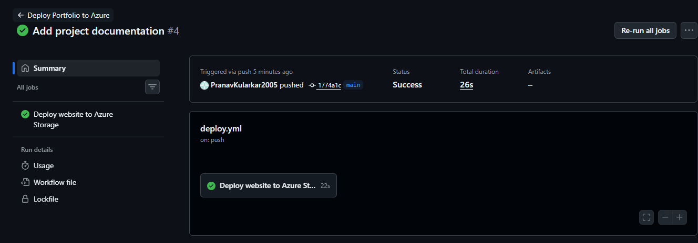
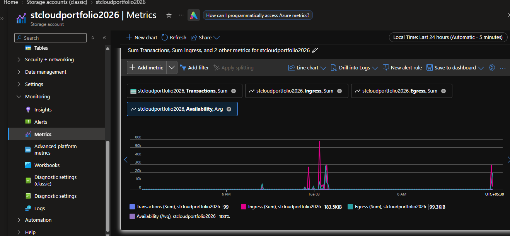

# Azure Cloud Portfolio with Automated Deployment

## About the Project

I built this project to learn how websites can be hosted on Microsoft Azure and how deployment can be automated using GitHub Actions.

It is a personal portfolio website developed using HTML, CSS and JavaScript. I hosted it using Azure Blob Storage Static Website Hosting and connected it with GitHub Actions so that whenever I push changes to my GitHub repository, the website files are automatically deployed to Azure.

I also used Azure Monitor to explore the activity and performance of my Storage Account.

## Live Website

[Visit My Portfolio](https://stcloudportfolio2026.z29.web.core.windows.net/)

## Technologies Used

- **HTML, CSS and JavaScript:** To build the portfolio website.
- **Git and GitHub:** To manage and store the project code.
- **Azure Blob Storage:** To host the website.
- **GitHub Actions:** To automate website deployment.
- **Microsoft Entra ID and OIDC:** To authenticate GitHub Actions with Azure.
- **Azure RBAC:** To provide deployment permissions.
- **Azure Monitor:** To check Storage Account metrics.

## How It Works

The deployment process works like this:

1. I develop or make changes to the website in VS Code.
2. I push the updated code to my GitHub repository.
3. GitHub Actions automatically starts the deployment workflow.
4. GitHub Actions connects to Azure using OIDC authentication.
5. The workflow uploads the website files to the `$web` container in Azure Storage.
6. The updated website becomes available through the Azure static website endpoint.

## Project Architecture

```text
VS Code
   |
   v
GitHub Repository
   |
   v
GitHub Actions
   |
   v
Microsoft Entra ID
   |
   | OIDC Authentication
   v
Azure Storage Account
   |
   v
$web Container
   |
   v
Live Portfolio Website

Azure Monitor
   |
   v
Storage Account Metrics
```

## What I Implemented

### 1. Portfolio Website

Created a personal portfolio with the following sections:

- Home
- About
- Skills
- Projects
- Education
- Contact

### 2. Website Hosting on Azure

Created an Azure Storage Account and enabled Static Website Hosting.

The website files are stored in the `$web` container.

- Storage Account: `stcloudportfolio2026`
- Website container: `$web`
- Index document: `index.html`
- Error document: `404.html`

### 3. Automated Deployment using GitHub Actions

Created a GitHub Actions workflow that runs whenever I push changes to the `main` branch.

This helped me avoid uploading the website files manually every time I made an update.

The workflow also includes a verification step to check the deployed HTML content.

### 4. Secure Azure Authentication

Used OpenID Connect (OIDC) to connect GitHub Actions with Microsoft Azure.

I configured an application identity in Microsoft Entra ID and assigned the required Azure permissions to the deployment identity.

### 5. Azure Monitoring

Used Azure Monitor Metrics Explorer to explore four Storage Account metrics:

| Metric | What it measures |
|---|---|
| Transactions | Storage requests |
| Availability | Storage service availability |
| Ingress | Data entering the Storage Account |
| Egress | Data leaving the Storage Account |

These metrics help me understand Storage Account activity. They do not represent the number of unique visitors to the website.

## Project Screenshots

### 1. Portfolio Website


### 2. Automated Deployment using GitHub Actions



### 3. Azure Monitor Metrics



## Project Structure

```text
azure-cloud-portfolio/
│
├── .github/
│   └── workflows/
│       └── deploy.yml
│
├── screenshots/
│   ├── portfolio.png
│   ├── github-actions.png
│   └── azure-monitor.png
│
├── .gitignore
├── index.html
├── style.css
├── script.js
├── 404.html
└── README.md
```

## What I Learned

While working on this project, I got practical experience with:

- Hosting a static website on Microsoft Azure.
- Using Git and GitHub to manage project files.
- Creating and running a GitHub Actions workflow.
- Connecting GitHub Actions to Azure using OIDC.
- Understanding Azure RBAC and deployment permissions.
- Uploading website files to Azure Blob Storage.
- Checking Storage Account metrics using Azure Monitor.
- Troubleshooting deployment and authentication issues.

This project helped me understand how GitHub and Azure can work together to automate website deployment.

## Author

**Pranav Kularkar**

Electronics Engineering Student

[GitHub Profile](https://github.com/PranavKularkar2005)